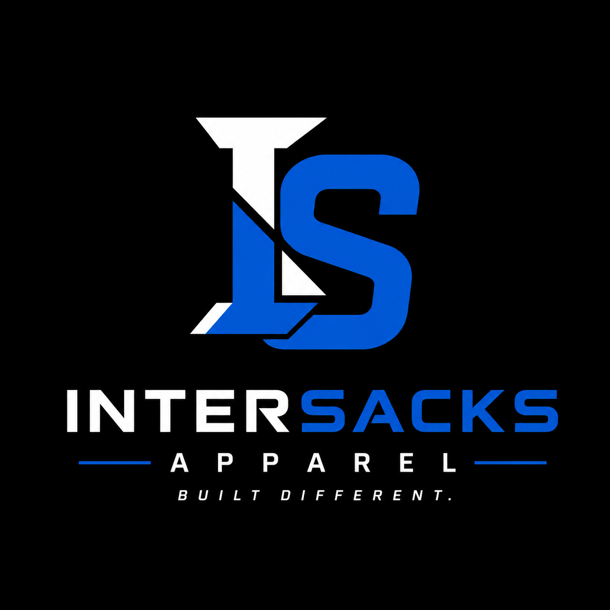

# InterSacks Apparel — Custom Streetwear MVP

Premium South African Streetwear. Built Different.

This is a data-driven, static website built with HTML5, CSS3, and Vanilla JavaScript. No backend, no database, no external dependencies — just clean code optimized for deployment on GitHub Pages.

---

## Project Architecture

### Folder Structure

```
intersacks-apparel/
│
├── index.html              ← Homepage
├── product.html            ← Product customization page
├── cart.html               ← Shopping bag page
│
├── css/
│   ├── style.css           ← All styling, colours, layout
│   ├── product.css         ← Product customizer & cart styling
│   └── responsive.css      ← Mobile / tablet breakpoints
│
├── js/
│   ├── data.js             ← Single source of truth (Garments & Designs)
│   ├── catalogue.js        ← Dynamic rendering functions
│   ├── customizer.js       ← Cart management & customization logic
│   ├── product.js          ← Product page interactivity
│   └── app.js              ← Navigation, menu, scroll animations
│
├── assets/
│   ├── logo/               ← Brand logo files
│   ├── hero/               ← Hero section background images
│   ├── products/           ← Existing product images
│   ├── icons/              ← SVG icons for contact
│   ├── reviews/            ← Customer review images
│   ├── garments/           ← Garment mockups (by type)
│   │   ├── tshirts/        ← Classic T-shirt mockups
│   │   ├── oversized/      ← Oversized T-shirt mockups
│   │   ├── long-sleeves/   ← Long sleeve mockups
│   │   ├── hoodies/        ← Hoodie mockups
│   │   ├── sweatshirts/    ← Crewneck mockups
│   │   ├── vests/          ← Vest mockups
│   │   └── caps/           ← Cap mockups
│   └── designs/            ← Design artwork files
│       ├── panther/        ← Panther design files
│       ├── skull/          ← Skull design files
│       ├── logo/           ← Logo design files
│       ├── typography/     ← Typography design files
│       ├── geometric/      ← Geometric design files
│       └── placeholders/   ← Coming soon placeholders
│
└── README.md               ← This file
```

### Data-Driven Architecture

All product data lives in `js/data.js`. The system has three core concepts:

#### 1. **Garments**
Physical items (T-shirt, Hoodie, etc.) with multiple colours and sizes.

#### 2. **Designs**
Artwork that can be applied to compatible garments in different placements.

#### 3. **Placements**
Where designs appear on garments (Front Small, Front Centre, Back Large).

---

## How to Add a New Garment

### Step 1: Create Mockup Images

Create TWO images for each colour:
- `garment-type-colour-front.png` (Front view)
- `garment-type-colour-back.png` (Back view)

**Folder:** `assets/garments/[type]/`

Example:
```
assets/garments/tshirts/
  ├── classic-black-front.png
  ├── classic-black-back.png
  ├── classic-white-front.png
  └── classic-white-back.png
```

### Step 2: Add Garment to `js/data.js`

Open `js/data.js` and find the `garments` array. Add a new object:

```javascript
const garments = [
  // ... existing garments ...
  {
    id: "your-garment-id",                    // unique identifier (lowercase, hyphenated)
    name: "Your Garment Name",                // display name
    category: "T-Shirts",                     // category name
    description: "Brief description...",      // 1-2 sentence description
    basePrice: 399,                           // price in cents (R3.99)
    colours: [
      {
        name: "Black",
        value: "#111111",
        frontImage: "assets/garments/tshirts/your-black-front.png",
        backImage: "assets/garments/tshirts/your-black-back.png"
      },
      {
        name: "White",
        value: "#FFFFFF",
        frontImage: "assets/garments/tshirts/your-white-front.png",
        backImage: "assets/garments/tshirts/your-white-back.png"
      }
      // Add more colours...
    ],
    sizes: ["S", "M", "L", "XL", "2XL"],      // available sizes
    featured: false,                          // show on homepage?
    active: true,                             // visible in shop?
    image: "assets/garments/tshirts/your-black-front.png"  // thumbnail
  }
];
```

### Complete Example: Adding a "Fitted Tee"

**Step 1:** Create mockups
```
assets/garments/fitted/
  ├── fitted-black-front.png
  ├── fitted-black-back.png
  ├── fitted-navy-front.png
  └── fitted-navy-back.png
```

**Step 2:** Add to `data.js`
```javascript
{
  id: "fitted-tee",
  name: "Fitted Tee",
  category: "T-Shirts",
  description: "Premium slim-fit cotton. Sharp and structured.",
  basePrice: 349,
  colours: [
    {
      name: "Black",
      value: "#111111",
      frontImage: "assets/garments/fitted/fitted-black-front.png",
      backImage: "assets/garments/fitted/fitted-black-back.png"
    },
    {
      name: "Navy",
      value: "#001A66",
      frontImage: "assets/garments/fitted/fitted-navy-front.png",
      backImage: "assets/garments/fitted/fitted-navy-back.png"
    }
  ],
  sizes: ["XS", "S", "M", "L", "XL"],
  featured: true,
  active: true,
  image: "assets/garments/fitted/fitted-black-front.png"
}
```

**Step 3:** Save `data.js` and refresh the website

✅ Your new garment appears on the "Shop by Garment" section immediately.

---

## How to Add a New Design

### Step 1: Create Design Files

Create artwork in transparent PNG format (1000×1000px recommended):
- `design-name.png` (Regular image for gallery)
- `design-name-transparent.png` (Transparent PNG for mockup overlay, optional)

**Folder:** `assets/designs/[category]/`

Example:
```
assets/designs/panther/
  ├── panther.png
  └── panther-transparent.png
```

### Step 2: Add Design to `js/data.js`

Open `js/data.js` and find the `designs` array. Add a new object:

```javascript
const designs = [
  // ... existing designs ...
  {
    id: "your-design-id",                    // unique identifier
    name: "Your Design Name",                // display name
    image: "assets/designs/category/design.png",              // gallery image
    transparentImage: "assets/designs/category/design-transparent.png",  // for mockup (optional)
    category: "Graphic",                     // Graphic, Logo, Typography, Limited, New
    additionalPrice: 50,                     // extra cost (0 if included)
    compatibleGarments: [
      "classic-tee",
      "oversized-tee",
      "hoodie"
      // List garment IDs this design works with
    ],
    placements: [
      "front-small",      // Small design on front (80px)
      "front-center",     // Medium design on front (180px)
      "back-large"        // Large design on back (240px)
    ],
    featured: false,      // show on homepage?
    active: true          // visible in shop?
  }
];
```

### Complete Example: Adding a "Dragon" Design

**Step 1:** Create artwork
```
assets/designs/dragon/
  ├── dragon.png
  └── dragon-transparent.png
```

**Step 2:** Add to `data.js`
```javascript
{
  id: "dragon-001",
  name: "Dragon",
  image: "assets/designs/dragon/dragon.png",
  transparentImage: "assets/designs/dragon/dragon-transparent.png",
  category: "Graphic",
  additionalPrice: 75,
  compatibleGarments: [
    "classic-tee",
    "oversized-tee",
    "long-sleeve",
    "hoodie",
    "crewneck",
    "vest"
  ],
  placements: ["front-center", "back-large"],
  featured: true,
  active: true
}
```

**Step 3:** Save `data.js` and refresh

✅ Your design appears in the "Choose Your Design" section with filtering and search.

---

## How to Add a Placeholder Design (Coming Soon)

For future designs without artwork yet:

```javascript
{
  id: "placeholder-drop004",
  name: "Drop 004",
  image: "assets/designs/placeholders/placeholder-drop004.png",
  transparentImage: null,
  category: "New",
  additionalPrice: 0,
  compatibleGarments: [],      // Empty = not selectable
  placements: [],
  featured: true,              // Show it as "Coming Soon"
  active: false                // Grayed out, not purchasable
}
```

---

## Configuration

All store settings are in `js/data.js`:

```javascript
const STORE_CONFIG = {
  whatsappNumber: "27721234567",           // Your WhatsApp number
  brandName: "InterSacks Apparel",
  tagline: "Built Different.",
  currency: "R"                            // Currency symbol
};
```

**To change your WhatsApp number:**
1. Open `js/data.js`
2. Find `STORE_CONFIG`
3. Update `whatsappNumber` with your WhatsApp number (country code + number, no spaces or symbols)

---

## Customization Features

### Price Calculation
Prices are automatically calculated:
```
Final Price = Garment Base Price + Design Additional Price
```

Example:
```
Oversized Tee (R349) + Panther Design (+R50) = R399
```

### Cart Management
- Customers can add multiple items
- Change quantities
- Remove items
- Cart persists using browser `localStorage`
- Survives page refreshes

### WhatsApp Ordering
When customers click "ORDER VIA WHATSAPP", a pre-formatted message is generated with:
- All items in their cart
- Colours, sizes, placements
- Total price
- Fields for name and delivery area

The message opens their WhatsApp app automatically.

---

## SEO & Metadata

Homepage metadata is in the `<head>` of `index.html`:

```html
<title>InterSacks Apparel | Built Different</title>
<meta name="description" content="InterSacks Apparel — South African streetwear...">
<meta property="og:title" content="InterSacks Apparel | Built Different" />
<meta property="og:description" content="..." />
```

Update these to match your branding.

---

## Responsive Design

The site is fully responsive:
- **320px** - Small phone
- **375px** - iPhone
- **430px** - Phone
- **768px** - Tablet
- **1024px** - Laptop
- **1440px+** - Desktop

All sections adapt automatically. Test with Chrome DevTools.

---

## Accessibility

- ✅ Semantic HTML5 (`<section>`, `<button>`, etc.)
- ✅ Keyboard navigation (Tab to navigate, Enter to select)
- ✅ ARIA labels on buttons and interactive elements
- ✅ Focus visible states
- ✅ Mobile menu is keyboard accessible
- ✅ Colour contrast meets WCAG AA standards
- ✅ Images have alt text

---

## Performance

- ✅ No external dependencies (no React, Vue, Bootstrap, Tailwind)
- ✅ Lazy loading for images
- ✅ Optimized CSS (only ~15KB)
- ✅ Minimal JavaScript (~10KB)
- ✅ Static assets only (no server needed)

**Total page size:** ~500KB with all images

---

## Deployment

This site runs perfectly on **GitHub Pages** at no cost.

### To Deploy:
1. Push to GitHub
2. Go to **Settings → Pages**
3. Set source to `main` branch
4. Site goes live at `https://yourusername.github.io/intersacks-apparel`

---

## Future Enhancements (Not Implemented Yet)

These features should NOT be falsely simulated with frontend code:

### Admin Dashboard
- Login (requires backend authentication)
- Upload new artwork
- Upload garment mockups
- Create/edit garment products
- Manage prices
- Manage stock status
- Activate/deactivate designs
- View orders

### Backend Services
- Order storage
- Customer data management
- Email notifications
- Payment processing
- Inventory tracking

When you're ready to scale, replace `js/data.js` with API calls:
```javascript
// Instead of static array:
const garments = await fetch('/api/garments').then(r => r.json());
const designs = await fetch('/api/designs').then(r => r.json());
```

All the UI code will continue to work unchanged.

---

## Browser Support

- ✅ Chrome (latest)
- ✅ Firefox (latest)
- ✅ Safari (latest)
- ✅ Edge (latest)
- ✅ Mobile browsers (iOS Safari, Chrome Android)

---

## Troubleshooting

### Images Not Showing?
1. Check file path in `data.js` matches actual image location
2. Use relative paths: `assets/images/file.png`
3. Image format must be `.png` or `.jpg`

### Cart Not Saving?
- Check browser allows localStorage (not in private mode)
- Clear browser cache and refresh

### WhatsApp Link Not Working?
- Verify `STORE_CONFIG.whatsappNumber` is correct
- Format: `country code + number` (e.g., `27721234567`)
- No spaces, dashes, or country symbols

---

## Code Quality Standards

- Clean, readable code
- No console errors
- No dead links
- Meaningful variable names
- Comments only where helpful
- No inline CSS or JavaScript
- No hardcoded data (all in `data.js`)
- Reusable functions
- Event delegation for performance

---

## License

© 2024 InterSacks Apparel. All rights reserved.
    ...
  </div>
  <div class="product-info">
    <h3 class="product-name">Oversized Skull Tee</h3>
    <div class="product-stars">★★★★★</div>
    <p class="product-price">R349</p>
    <p class="product-status coming-soon">Coming Soon</p>
  </div>
</div>
```

**Step 3** — Replace the placeholder `<div>` with a real image tag:

```html

```

**Step 4** — Update the name, price and status:

```html
<h3 class="product-name">New Product Name</h3>
<p class="product-price">R499</p>
<p class="product-status in-stock">In Stock</p>
```

**Status options:**

| Class | Label | Use When |
|---|---|---|
| `coming-soon` | Coming Soon | Not launched yet |
| `in-stock` | In Stock | Available to buy |
| `sold-out` | Sold Out | Finished |

Done. No coding needed.

---

## How to Replace the Hero Image

1. Add your image: `assets/hero/hero-bg.jpg`
2. In `css/style.css`, find `.hero-bg` and replace the gradient with:

```css
.hero-bg {
  position: absolute;
  inset: 0;
  background-image: url('../assets/hero/hero-bg.jpg');
  background-size: cover;
  background-position: center;
}
```

---

## How to Update Contact Info

In `index.html`, find the contact section and replace:

```html
<!-- Email -->
<a href="mailto:hello@intersacks.co.za" ...>
  <p>hello@intersacks.co.za</p>
</a>

<!-- WhatsApp -->
<a href="https://wa.me/27000000000" ...>
  <p>+27 000 000 000</p>
</a>

<!-- Instagram -->
<a href="https://instagram.com/YOUR_HANDLE" ...>
  <p>@yourhandle</p>
</a>

<!-- Facebook -->
<a href="https://facebook.com/YOUR_PAGE" ...>
  <p>InterSacks Apparel</p>
</a>
```

---

## How to Add Your Logo

1. Save your logo as `assets/logo/logo.png` (transparent background, PNG or SVG)
2. In `index.html`, find the navbar logo section:

```html
<a href="#home" class="nav-logo">
  <!-- Replace with:  -->
  <span class="logo-text">INTERSACKS</span>
</a>
```

3. Replace with:

```html
<a href="#home" class="nav-logo">
  
</a>
```

---

## Colours

| Name | Hex | Where |
|---|---|---|
| Black | `#111111` | Background |
| White | `#FFFFFF` | Text |
| Blue | `#0066FF` | Accent, buttons, stars |

To change the accent colour sitewide, open `css/style.css` and update:

```css
--blue: #0066FF;
```

---

## Fonts

| Role | Font |
|---|---|
| Headings | Bebas Neue |
| Body | Poppins |

Loaded from Google Fonts in `<head>` — no install needed.

---

## Future Sections (Already Hidden)

When you're ready to add more, these sections are outlined in the design doc and can be added below the existing collections grid:

- Hoodies grid
- Sweatpants grid
- Accessories grid
- Limited Drops
- Lookbook
- Newsletter signup
- FAQ accordion
- Customer Reviews

Add each as a new `<section>` block following the same card pattern used in the collections section.

---

## Deployment

This site is pure HTML/CSS/JS — no server needed.

**Options:**
- Drag the folder into [Netlify Drop](https://app.netlify.com/drop) — free, instant
- Upload to any web host via FTP
- GitHub Pages (free hosting with a GitHub account)

---

## Browser Support

Supports all modern browsers: Chrome, Firefox, Safari, Edge.
Mobile tested at 320px, 375px, 414px widths.

---

© 2025 InterSacks Apparel
